<!-- SPDX-License-Identifier: MIT -->
<div align="center">

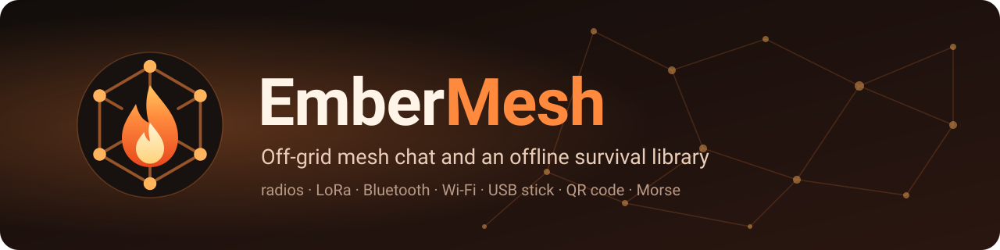

**Off-grid chat and an offline survival library, for when the network is gone.**<br>
No internet needed, no accounts, no servers of its own: every phone, computer or browser is a node
that stores, carries and forwards messages over whatever link it has. An optional internet relay,
off until you turn it on, reaches contacts far away while a connection exists.

<!--
  Status badges use repository-relative URLs (../../actions/..., ../../releases/...), which GitHub
  resolves against this repository, so forks work unchanged. If a mirror or another renderer shows
  them broken, replace "../.." with the absolute repository URL, for example
  https://github.com/<owner>/embermesh/actions/workflows/core.yml/badge.svg
-->
[](../../actions/workflows/core.yml)
[](../../actions/workflows/desktop.yml)
[](../../actions/workflows/web.yml)
[](../../actions/workflows/android.yml)
[](../../actions/workflows/ios.yml)
[](../../actions/workflows/guides.yml)
[](../../actions/workflows/checks.yml)
[](../../actions/workflows/release.yml)
[](../../actions/workflows/pages.yml)
<br>
[](LICENSE)
[](guides/LICENSES.md)
[](#supported-platforms-and-hardware)

[**Open the web app or download**](../../releases/tag/latest) · [Quick start](guides/content/embermesh/quick-start.md) ·
[Operator manual](#documentation) · [How it works](#how-it-works) · [Build from source](#building-and-testing)

</div>

---

EmberMesh is a chat app and a reference library that keep working when phone networks, the
internet and power grids do not. Two phones can talk over Bluetooth with nothing else around, and
apps on the same Wi-Fi or hotspot find each other and link up by themselves. A
laptop or phone on its own Wi-Fi hotspot becomes a **hub**: anyone nearby opens a web page and is
on the mesh. Plug a cheap handheld radio into that hub through a sound card and the whole group can
reach another camp kilometres away. Messages that cannot be delivered yet are kept and carried —
by anyone walking between the groups, or on a USB stick, or as a series of QR codes.

Beside the chat sits a library of **5,301 offline guides** — first aid, water, food, shelter,
radio, repair, power and more — plus a 33-chapter operator manual, searchable by keywords and by meaning, with 60 field calculators
and Morse by light: type a message and the phone flashes it; point another camera roughly at the
blinking light and it finds the light by itself and reads it (a tone through the microphone works
too). The same C++17 core runs on Android, iOS, Linux, macOS, Windows and in any modern
browser as WebAssembly, so every device behaves the same way. In a browser it installs as an
offline app, and a hosted copy of the web app is one click away under **Open the web app** above.

<table>
  <tr>
    <td align="center">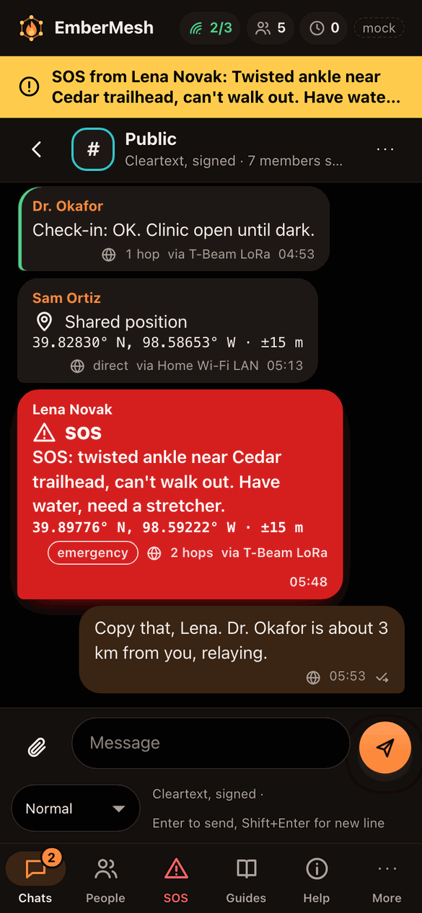<br><sub>Chat — SOS, check-ins, positions</sub></td>
    <td align="center">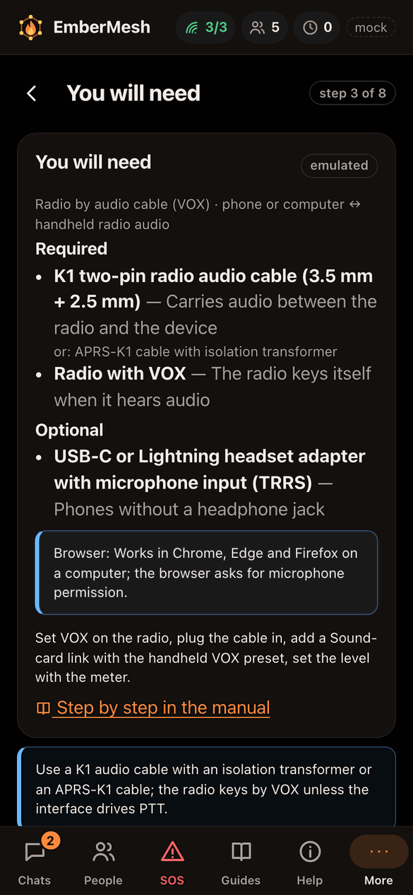<br><sub>Connect a radio — what you need</sub></td>
    <td align="center">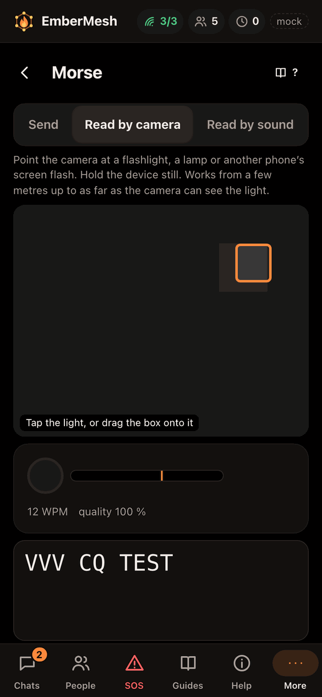<br><sub>Morse reader — finds the light itself</sub></td>
    <td align="center">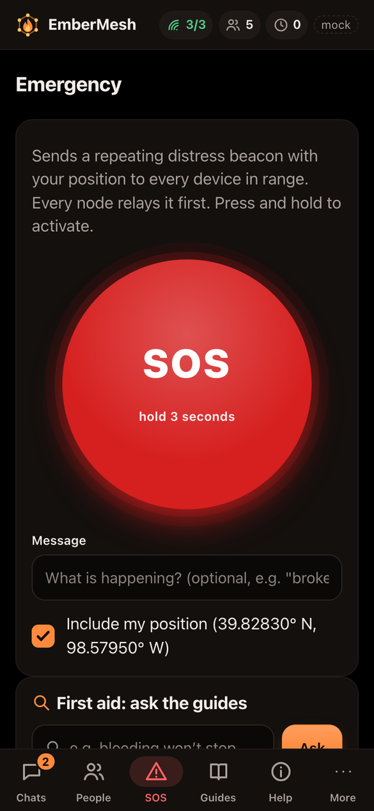<br><sub>SOS beacon — hold to send</sub></td>
  </tr>
</table>
<table>
  <tr>
    <td align="center">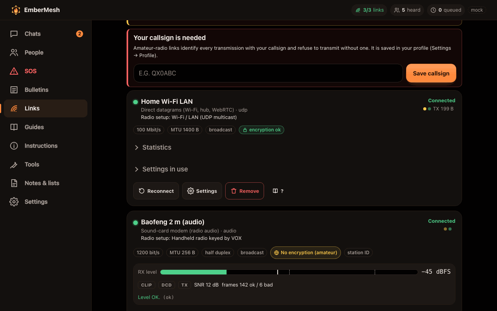<br><sub>Links &amp; radios — live levels, automatic links tagged</sub></td>
    <td align="center">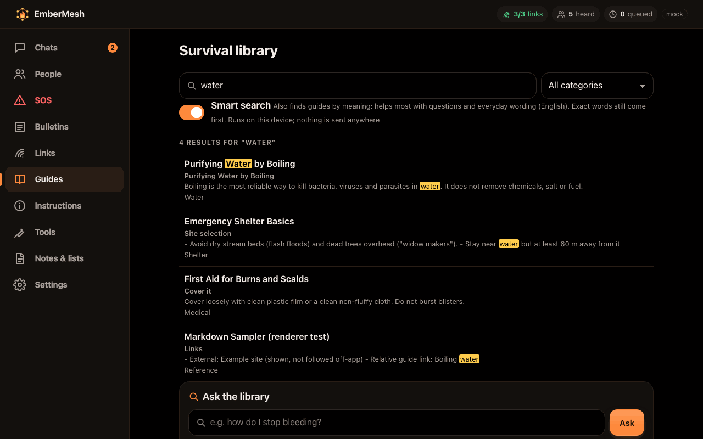<br><sub>Library — keyword and smart search</sub></td>
  </tr>
  <tr>
    <td align="center">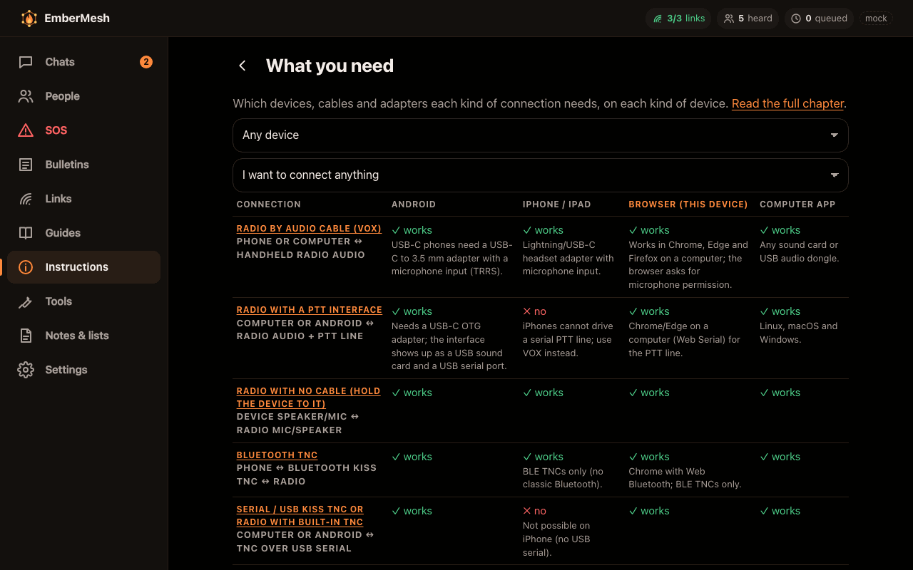<br><sub>Instructions — hardware for every connection</sub></td>
    <td align="center">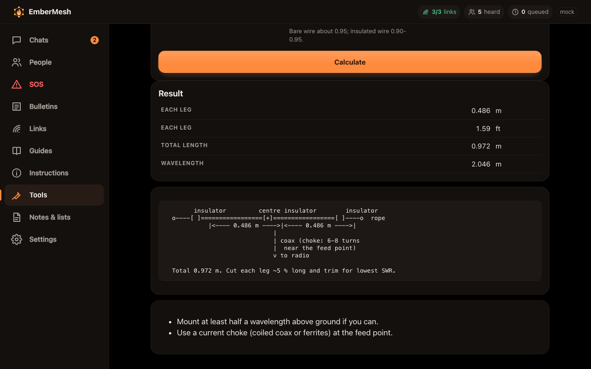<br><sub>Tools — antenna designer with build diagram</sub></td>
  </tr>
  <tr>
    <td align="center" colspan="2">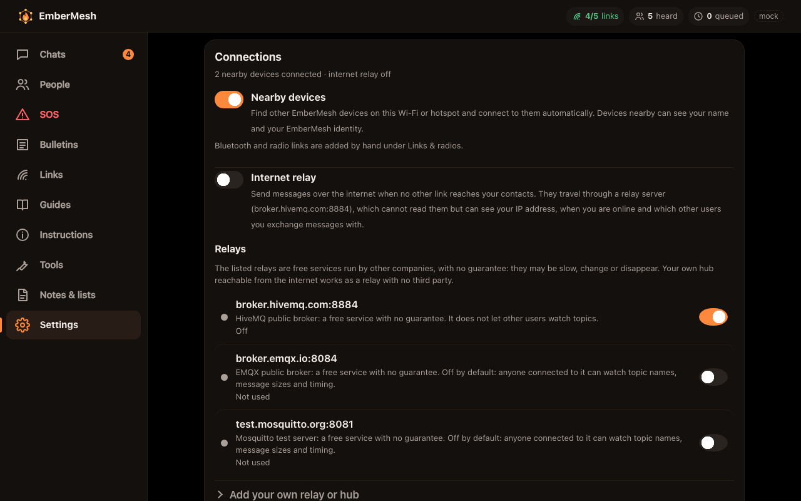<br><sub>Connections — nearby devices, and the optional relay with what it can see</sub></td>
  </tr>
</table>
<sub>Screenshots from the shared UI with its built-in demo backend (<code>ui/?mock=1</code>); names, places and positions are fictional sample data.</sub>

## A note from the maintainer

I wanted to make something that could benefit other people. When the infrastructure is gone,
people should still be able to reach each other and look things up, and they should not need
permission, an account or a company's servers to do it.

EmberMesh is free for anyone to use, copy, improve and pass on. If you have radios, cables, LoRa
boards or just two old phones, please try it with real gear and tell me what worked and what did
not — that is the part I could not test on my own. And I hope nobody ever needs it.

## Project status

EmberMesh is new and has not been field-tested. What **is** covered by automated tests: the core's
unit tests (protocol, cryptography, mesh, modems, Morse decoding, guides, tools), multi-process mesh
tests of the desktop daemon over every IP, serial and simulated audio/radio channel, browser tests
of the WebAssembly app in headless Chrome, and integration tests on the Android emulator and the
iOS simulator. Radio paths are tested through simulated channels — noise, band limits, VOX clipping
— not through real radios.

**Real radios, TNCs, LoRa boards, SDR dongles, cables, Bluetooth between real phones and real
microphones have not been tested yet.** Test your own setup before you rely on it, and keep other
ways to communicate. Each platform's README and the
[Troubleshooting and known limits](guides/content/embermesh/troubleshooting.md) chapter list
exactly what has and has not been exercised, and how to test a link yourself.

## Get it

**Download a build.** Every commit to `main` is built and tested by GitHub Actions, and its
binaries are published to the rolling [**latest** release](../../releases/tag/latest):

| Platform | What you get |
|---|---|
| Android 5.0+ | APK — copy it to the phone and open it, or `adb install` it |
| Linux, macOS, Windows | `emberd`: node, hub and radio gateway in one program |
| Any browser | the web app as a static site and as **one self-contained HTML file** that works from a USB stick |
| All apps | `guides.pack`, the guide library with its search index |
| iOS 15+ | no download (an `.ipa` needs Apple signing); build it with Xcode and sign it with your own Apple ID — [apps/ios/README.md](apps/ios/README.md) |

The latest release is rebuilt from every commit and is a development build. The Android release
APK is signed in CI with the publisher's own release key (when the repository's signing secrets
are set — [docs/CI.md](docs/CI.md#release-signing)) and is then named `…-android-release.apk`, so it
updates earlier copies signed with that key. An APK named `…-release-ci-debug-signed.apk` (or one
from another builder) carries a throw-away key and will not install over it as an update
(uninstall first). The release notes give the signing certificate's SHA-256.

**Or build it yourself** — see [Building and testing](#building-and-testing). Once the toolchains
are on disk, everything builds offline.

**Spreading it with no internet:** a hub serves the app and its downloads to everyone who joins
it, an Android phone can pass its own APK on through the share sheet, and the single HTML file
runs from a USB stick — see [Getting the app onto other people's devices](guides/content/embermesh/spreading-the-app.md).

## What it does

| | |
|---|---|
| 💬 **Chat** | Direct messages (end-to-end encrypted), channels (random key, passphrase or open), a signed cleartext Public channel, delivery and read receipts, priorities, small files |
| 🕸️ **Mesh** | Managed flooding with store-carry-forward: undelivered messages are kept for days and handed to every newly met peer. A node with several links bridges them automatically |
| 🆘 **Emergency** | Repeating SOS beacon relayed first by every node, safety check-ins and roll call, a bulletin board (water, food, medical, shelter, hazards), position sharing, typed messages sent as Morse by flashlight, screen or tone |
| 📻 **Radios** | Sound-card soft modems through any radio's audio, KISS TNCs with APRS messaging, Meshtastic, RNode, AT-command LoRa modules, transparent serial radios, receive-only SDR |
| 📶 **Device to device** | **Nearby devices:** apps on the same Wi-Fi or hotspot find each other and connect by themselves. Also Bluetooth LE phone-to-phone, Wi-Fi multicast, Apple peer-to-peer, WebRTC paired by QR code, TCP, serial cable, USB-stick and QR-code bundles |
| 🌐 **Internet relay** (optional) | Off until you turn it on. Then contacts are also reached over any internet connection (LTE, satellite) through relay servers that carry sealed frames: they see addresses, sizes and timing, never content. One free third-party relay is enabled by default; your own hub can be a private relay instead (`emberd --relay-broker`) |
| 🏕️ **Hub** | A computer or phone serves the app on its own hotspot at `http://<ip>:8437/`; browsers that open it join the mesh. Add a radio and the whole hotspot reaches distant groups |
| 📚 **Library** | 5,301 guides in 19 categories plus a 33-chapter operator manual, keyword and meaning-based search, every guide with its source and licence |
| 🧭 **Easy to use** | Simple mode (bigger text and buttons, fewer choices, plain words) and accessibility settings: text size, high contrast, motion, reading spacing, vibration, keyboard shortcuts, screen-reader labels. The same short 3D launch animation in every app, which can be shortened or turned off and follows the system's reduced-motion setting |
| 🧮 **Tools** | 60 calculators, including 19 antenna designers with build diagrams, link budget, radio horizon, coax loss, solar and battery sizing, grid conversion, water disinfection; band plans for 36 radio services |
| 🔐 **Your data** | Storage encrypted with a passphrase, duress passphrase, panic wipe, identity backup, contact verification by 8 words read over the radio or by QR card |

<details>
<summary><b>Radios and modems in detail</b></summary>

- **Sound-card modems** (any radio with a speaker and a microphone input): AFSK 1200 (APRS
  compatible), AFSK 300, PSK 2400/4800, a slow, robust FEC mode for weak signals, plus CW, RTTY,
  PSK31 and DTMF. Presets for a handheld keyed by **VOX**, a handheld with a **PTT interface**
  (AIOC, Digirig, CM108 dongles, serial RTS/DTR, Hamlib `rigctld`), **acoustic coupling** (no
  cable: hold the phone to the radio) and base radios with a data port.
- **Measured in simulation** ([core/src/modem/PERFORMANCE.md](core/src/modem/PERFORMANCE.md)): AFSK
  1200 decodes half its frames at about 5 dB SNR (3 kHz bandwidth); the slowest robust mode at
  about −15 dB. Real radios add distortion that simulation does not.
- **"Connect a radio" wizard:** pick the radio (a small offline database of common handhelds such
  as the Baofeng UV-5R family, plus generic entries), see the exact cables and adapters needed on
  your device, set the radio, set the level with a live meter, send a test.
- **Packet and LoRa:** KISS TNCs over serial, Bluetooth or TCP (Direwolf, Mobilinkd, TNC-Pi,
  radios with built-in TNCs) with APRS text-message interop; Meshtastic devices (text channel
  interop); RNode; AT-command LoRa modules; transparent serial radios; receive-only RTL-SDR via
  `rtl_tcp`.
- **Amateur bands:** links flagged as amateur only ever carry cleartext, signed traffic identified
  by your callsign; encrypted traffic is never forwarded onto them, and they refuse to transmit
  without a callsign.

</details>

<details>
<summary><b>Morse reader</b></summary>

Point the camera roughly at a flashlight, a lamp or another phone's screen, or let the microphone
hear a tone, and the text appears as it is decoded. The camera reader watches the whole frame and
finds the keyed light by itself — no box to place — ignoring steady lamps, flicker and hand shake;
tap a light to choose it when there are two. One decoder in the core serves every app and finds the
speed by itself. **Sending:** type text and the device flashes it with its flashlight, or with the
screen when it has none, or plays it as a tone.

Measured **in simulation only** ([core/src/morse/README.md](core/src/morse/README.md)): the camera
reader locks on in about 1–1.5 s at 12–15 WPM and needs about two camera frames per dot (30 fps:
up to ~20 WPM); a one-pixel light in a dark room must stand roughly 20–40 brightness levels above
its background, and daylight scenes are much harder. It has been tested with generated scenes, not
yet with a real lamp in real light — see [Sending and reading Morse](guides/content/embermesh/morse-reading.md).

</details>

<details>
<summary><b>Smart search</b></summary>

Search combines keyword ranking with meaning-based ranking from a small text-embedding model
(potion-base-4M by Minish Lab, MIT-licensed, 2.35 MB with 4-bit weights) that runs on the device, inside the core, with no network, so a question in everyday words can find a
guide that uses different ones. **Ask the library** returns the passages that best answer a
question — always quoted from the guides, never generated text. Exact terms (names, part numbers,
callsigns) still rank first. The model and the passage vectors travel inside `guides.pack`; a pack
without them falls back to keyword search. Details: [docs/RPC_API.md §7](docs/RPC_API.md#7-semantic-search--a-small-local-model-additive).

</details>

## How it works

All protocol logic lives in one portable C++17 core with no dependencies beyond its vendored
cryptography. The platform apps only move bytes and audio samples to hardware ("endpoints"), and
one web UI runs on top of everything.

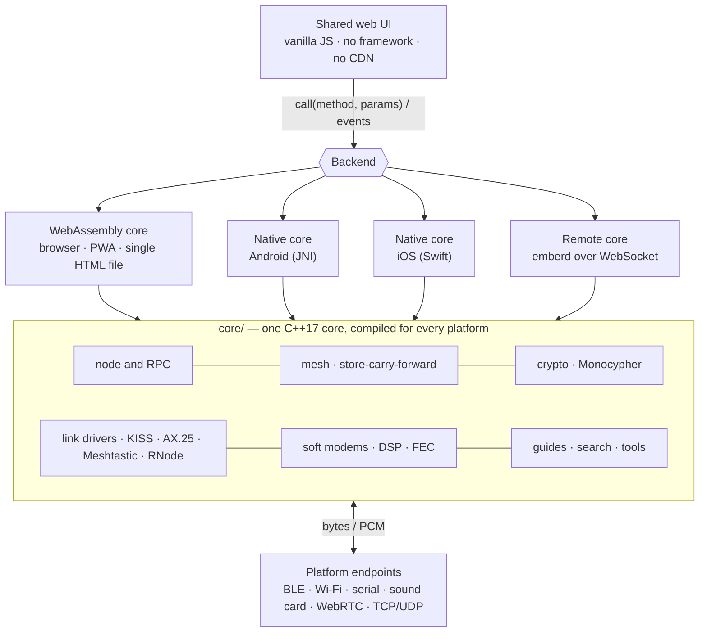

**Ways to connect** — mix them freely; every node with two links is a bridge:

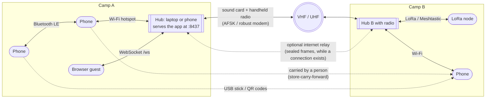

Devices on the same Wi-Fi find each other through DNS-SD and connect without setup; browsers cannot
discover the network, so they join the hub that served them or pair by code. Details:
[docs/CONNECTIVITY.md](docs/CONNECTIVITY.md).

<details>
<summary><b>Mesh, security and storage in more detail</b></summary>

- **Identity:** each device makes its own signing and key-agreement keys on first run. People
  verify each other with 8 words that can be read aloud over a voice radio, or with a QR card.
- **Routing:** managed flooding (TTL, duplicate cache, rebroadcast suppression) plus
  store-carry-forward with reconciliation whenever two nodes meet; end-to-end acknowledgements
  purge delivered copies.
- **Slow links first:** compact binary headers, fragmentation for small MTUs, strict priorities
  (SOS before everything), airtime budgets and text compression.
- **Wire format** and every bound a receiver enforces: [docs/PROTOCOL.md](docs/PROTOCOL.md).

</details>

## Security in brief

- **Cryptography:** [Monocypher](https://monocypher.org) 4.0.2, vendored unmodified — X25519,
  Ed25519, XChaCha20-Poly1305, BLAKE2b, Argon2id. Direct messages and private channels are
  end-to-end encrypted and authenticated; everything public is signed.
- **Hostile input is the normal case.** Every parser is bounded and rejects malformed data. Unknown
  senders get strict budgets and a small storage share, so they cannot crowd out your
  conversations, cancel someone else's SOS, withdraw bulletins or forge acknowledgements. Replays are remembered across restarts. A device with a
  working clock never lets the mesh change it. Guide packs from others are validated before use.
- **On the device:** passphrase-encrypted storage, a duress passphrase, panic wipe; hubs never
  announce the computer's or phone's own name.
- **Nearby devices and the relay:** Nearby shows your name and EmberMesh identity to every
  EmberMesh device on the same network. The internet relay sends nothing before you consent; its
  frames are sealed end to end, but the relay operator sees your IP address, when you are online
  and which other users you exchange messages with, and on brokers that allow wildcard subscriptions
  anyone can watch topic names, sizes and timing. A single default relay is a single point of
  failure. See [SECURITY.md](SECURITY.md) and [docs/CONNECTIVITY.md](docs/CONNECTIVITY.md) §2, §4.5.
- **Limits, stated plainly:** no forward secrecy for direct messages; who talks to whom and when is
  visible to anyone in radio range; passphrase channels can be guessed offline (prefer random-key
  channels shared by invite); "verified" only means something for contacts you verified yourself,
  so do that before an emergency. The code has not had an independent security audit.

Threat model and mechanisms: [docs/PROTOCOL.md §4, §9–§12](docs/PROTOCOL.md#4-security) and the
[security chapter](guides/content/embermesh/security.md) of the manual. To report a vulnerability,
see [SECURITY.md](SECURITY.md).

## Supported platforms and hardware

| | Runs as | Links it can use |
|---|---|---|
| **Android** 5.0+ | native app (Kotlin + C++ core) | Nearby devices, internet relay, Bluetooth LE, Bluetooth SPP, USB serial (FTDI, CP210x, CH34x, PL2303, CDC-ACM), USB / jack audio, Wi-Fi, Wi-Fi Direct, phone hub |
| **iPhone / iPad**, iOS 15+ | native app (Swift + C++ core) | Nearby devices, internet relay, Bluetooth LE, Apple peer-to-peer, audio (VOX only: iOS cannot key PTT), Wi-Fi, phone hub |
| **Linux** (incl. Raspberry Pi), **macOS**, **Windows** | `emberd` daemon + web UI | Nearby devices (built-in mDNS), internet relay (TLS through Mbed TLS) and a private relay broker, serial, sound cards with VOX / RTS / DTR / CM108 / `rigctld` PTT, TCP/UDP, `rtl_tcp`, Wi-Fi hub |
| **Browser** (Chrome / Edge tested) | WebAssembly app: installable offline PWA, hosted web app or single HTML file | internet relay, WebSocket to a hub, WebRTC, Web Serial and Web Bluetooth (Chrome), audio modem; no Nearby discovery (a page cannot search the network: it joins a hub or pairs by code) |

**Radio hardware the software supports** (none of it field-tested yet): handhelds such as the
Baofeng UV-5R through a K1 audio cable on VOX or through an AIOC / Digirig-class interface;
CM108-style USB sound cards; KISS TNCs (Mobilinkd TNC3/TNC4, TNC-Pi, Direwolf, radios with a
built-in TNC); Meshtastic boards; RNode; AT-command LoRa modules (REYAX-class); transparent serial
radios; RTL-SDR dongles for listening. The full list per platform, with every cable and adapter,
is in [What you need](guides/content/embermesh/what-you-need.md).

## The guide library

5,301 guides in 19 categories plus the 33-chapter operator manual — about 80 MB of Markdown, packed
into one 58.2 MB `guides.pack` with a prebuilt keyword index, the search model and passage vectors. Every guide records its source, licence and attribution, and the app shows
them at the bottom of each guide.

| Category | Guides | Category | Guides | Category | Guides |
|---|---:|---|---:|---|---:|
| Medical | 928 | Weather | 195 | Navigation | 120 |
| Agriculture | 629 | Electronics | 157 | Security | 81 |
| Repair | 560 | Community | 139 | Fire | 78 |
| Survival | 503 | Water | 107 | Signaling | 58 |
| Food | 467 | Hygiene | 139 | EmberMesh manual | 33 |
| Hazards | 459 | Power | 138 | Reference | 29 |
| Radio | 281 | Shelter | 233 | | |

Sources are public-domain US Government works (Army field manuals approved for public release,
FEMA, CDC, NOAA, USDA, US Coast Guard and others), public-domain books published in 1930 or
earlier, Wikipedia, Wikibooks and Wikivoyage (CC BY-SA 4.0), Appropedia (CC BY-SA 3.0), Open RN
nursing textbooks (CC BY 4.0) and the project's own CC0 operator manual. Some sources are old and
contain dated advice, marked with editor's notes; illustrations are not reproduced. The guides are
information, not a substitute for trained help. Licence breakdown and your obligations when you
pass guides on: [guides/LICENSES.md](guides/LICENSES.md).

## Documentation

The **operator manual** is inside every app (Guides → "How to use EmberMesh") and in
[`guides/content/embermesh/`](guides/content/embermesh/):

| Getting started | Connecting things | Radio | In the field |
|---|---|---|---|
| [1 Quick start](guides/content/embermesh/quick-start.md) | [11 What you need](guides/content/embermesh/what-you-need.md) | [16 Radio gateway](guides/content/embermesh/radio-gateway.md) | [25 Sneakernet](guides/content/embermesh/sneakernet.md) |
| [2 How it works](guides/content/embermesh/how-it-works.md) | [12 Phone to phone](guides/content/embermesh/phone-to-phone.md) | [17 Handhelds + sound-card modem](guides/content/embermesh/handheld-audio-modem.md) | [26 Emergency use](guides/content/embermesh/emergency-use.md) |
| [3 Android app](guides/content/embermesh/app-android.md) | [13 Connections: nearby and internet relay](guides/content/embermesh/connections.md) | [18 Baofeng UV-5R](guides/content/embermesh/baofeng-uv5r.md) | [27 Morse by light and sound](guides/content/embermesh/morse-reading.md) |
| [4 iPhone and iPad](guides/content/embermesh/app-ios.md) | [14 Spreading the app](guides/content/embermesh/spreading-the-app.md) | [19 KISS TNCs and packet](guides/content/embermesh/kiss-tnc-packet.md) | [28 Security](guides/content/embermesh/security.md) |
| [5 Web app](guides/content/embermesh/app-web.md) | [15 Setting up a hub](guides/content/embermesh/hub-setup.md) | [20 LoRa](guides/content/embermesh/lora.md) | [29 Power and field operation](guides/content/embermesh/power-and-field.md) |
| [6 Computer hub (emberd)](guides/content/embermesh/app-desktop.md) | | [21 SDR listening](guides/content/embermesh/sdr-listening.md) | [30 Troubleshooting and limits](guides/content/embermesh/troubleshooting.md) |
| [7 Tour of every screen](guides/content/embermesh/screens-tour.md) | | [22 Antennas you can build](guides/content/embermesh/antennas.md) | [31 Glossary and quick reference](guides/content/embermesh/quick-reference.md) |
| [8 Simple mode and accessibility](guides/content/embermesh/accessibility.md) · [9 Finding guides](guides/content/embermesh/library-search.md) · [10 Settings reference](guides/content/embermesh/settings-reference.md) | | [23 Relays and repeaters](guides/content/embermesh/relays-and-repeaters.md) · [24 Running a net](guides/content/embermesh/running-a-net.md) | [32 Building from source](guides/content/embermesh/building-from-source.md) · [33 Licences and credits](guides/content/embermesh/licences.md) |

**For developers:** [docs/ARCHITECTURE.md](docs/ARCHITECTURE.md) (design and layout) ·
[docs/RPC_API.md](docs/RPC_API.md) (app ↔ core contract) · [docs/PROTOCOL.md](docs/PROTOCOL.md)
(wire format, security) · [docs/CONNECTIVITY.md](docs/CONNECTIVITY.md) (Nearby devices, internet
relay) · [docs/CI.md](docs/CI.md) (workflows, release signing) · platform READMEs: [desktop](apps/desktop/README.md) ·
[web](apps/web/README.md) · [Android](apps/android/README.md) · [iOS](apps/ios/README.md) ·
[shared UI](ui/README.md) · [guide packer](tools/guidepack/README.md).
Working rules for contributors and automated coding tools: [AGENTS.md](AGENTS.md), with
step-by-step playbooks in [`.claude/skills/`](.claude/skills/).

## Building and testing

```sh
./build.sh doctor        # which toolchains were found, what this machine can build
./build.sh all           # guides + desktop + web + Android + iOS (skips what it cannot build)
./build.sh test          # every test suite that can run here (add --device-tests for emulator/simulator)
./build.sh privacy       # the publishing gate (also part of `test`)
```

| Target | Output | Needs |
|---|---|---|
| `desktop` | `dist/desktop/emberd` — run it, open `http://localhost:8437/` | C++17 compiler, CMake ≥ 3.20 |
| `web` | `dist/web/` and the single file `dist/web/embermesh.html` | Emscripten in `.toolchains/emsdk`, Node ≥ 22 ([apps/web](apps/web/README.md)) |
| `android` | `dist/android/*.apk` | Android SDK + NDK, JDK 17+ ([apps/android](apps/android/README.md)) |
| `ios` | `dist/ios/…/EmberMesh.app` (simulator, unsigned device) | macOS with Xcode ([apps/ios](apps/ios/README.md)) |
| `guides` | `build/guides.pack` | C++17 compiler, CMake |

The shared UI has no build step: `cd ui && python3 -m http.server 8000` and open
`http://localhost:8000/?mock=1` for the demo backend; `node --test ui/tests/` runs its unit tests.
On Windows, `.\build.ps1 desktop` builds `emberd` with MSVC (and `.\build.ps1 test` runs the native suites).
To see every app on one mesh at once — a desktop hub, a browser guest, the Android emulator and the
iOS simulator relaying each other's messages — run `node tools/e2e/all_together.mjs`
([tools/e2e](tools/e2e/README.md)).

### Build & test status

Every workflow runs on each push to `main`. Each job writes its test
counts — passed, failed, skipped per suite — to the **summary of its run**, so the numbers for any
commit are one click from its badge. A red badge means the latest run on `main` failed; the run
summary says which step.

| Workflow | What it builds and tests | Status | Artifacts |
|---|---|---|---|
| [Core](../../actions/workflows/core.yml) | the C++ core and host library, and their unit tests | [](../../actions/workflows/core.yml) | test reports in the run |
| [Desktop](../../actions/workflows/desktop.yml) | `emberd` on Linux, macOS and Windows; host and multi-process mesh tests | [](../../actions/workflows/desktop.yml) | run artifacts; `emberd` for each OS in [latest](../../releases/tag/latest) |
| [Web](../../actions/workflows/web.yml) | WebAssembly core, PWA, single HTML file; UI unit tests and headless-Chrome end-to-end tests | [](../../actions/workflows/web.yml) | run artifacts; web app in [latest](../../releases/tag/latest) |
| [Android](../../actions/workflows/android.yml) | the APKs and the Android test suites | [](../../actions/workflows/android.yml) | run artifacts; APKs in [latest](../../releases/tag/latest) |
| [iOS](../../actions/workflows/ios.yml) | the app for the simulator and an unsigned device build; XCTest on the simulator | [](../../actions/workflows/ios.yml) | run artifacts only (no `.ipa`: needs Apple signing) |
| [Guides](../../actions/workflows/guides.yml) | validates all guides and their licences, builds `guides.pack`, checks search | [](../../actions/workflows/guides.yml) | run artifacts; `guides.pack` in [latest](../../releases/tag/latest) |
| [Publish checks](../../actions/workflows/checks.yml) | the publishing gate (`tools/check-publishable.sh` and its self-test), licence and required-file checks | [](../../actions/workflows/checks.yml) | report in the run summary |
| [Release](../../actions/workflows/release.yml) | collects the binaries of a `main` commit and updates the rolling `latest` release | [](../../actions/workflows/release.yml) | [releases/tag/latest](../../releases/tag/latest) |
| [Pages](../../actions/workflows/pages.yml) | publishes the tested web app (with the guide library) as a static site; installable as an offline app | [](../../actions/workflows/pages.yml) | the live site: its address opens the notes of [latest](../../releases/tag/latest) and is in this repository's About box |

All runs: [Actions](../../actions).

## Contributing

Bug reports from real hardware are the most valuable contribution right now: what you connected,
which settings, what happened. Code, guide texts and translations are welcome too. Read
[CONTRIBUTING.md](CONTRIBUTING.md) for building, testing, the sample-data conventions and the
publishing gate; report security problems privately as described in [SECURITY.md](SECURITY.md).

## Licences

- **Code:** [MIT License](LICENSE) — Copyright (c) 2026 Joe.
- **Third-party components** (Monocypher, miniaudio, Mbed TLS, ZXing core, the potion-base-4M
  search model, parts of Project Nayuki's QR Code generator, doctest, the Gradle wrapper):
  their own permissive licences, listed with full texts in
  [THIRD_PARTY_LICENSES.md](THIRD_PARTY_LICENSES.md).
- **Guide library:** each guide under its own licence — public domain, CC0, CC BY 4.0 or
  CC BY-SA 3.0/4.0 — shown in the guide itself; see [guides/LICENSES.md](guides/LICENSES.md).
  CC BY-SA guides stay CC BY-SA wherever they go.
- **Logo and banner** (`docs/assets/`): part of this repository, MIT like the code.
